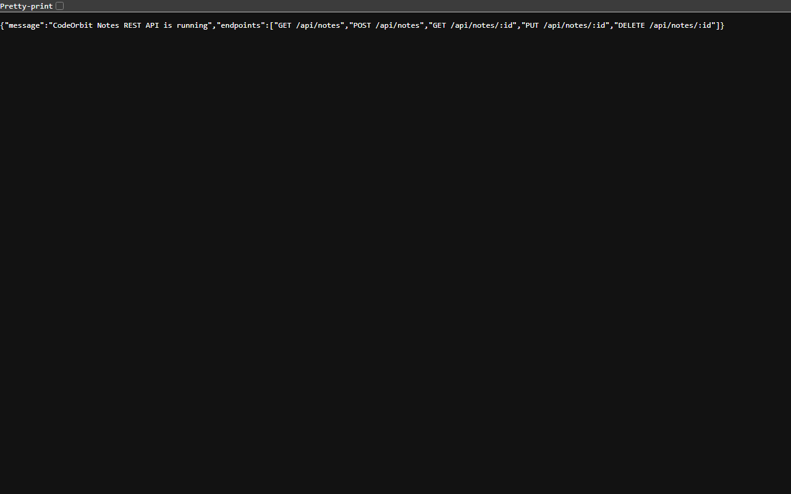
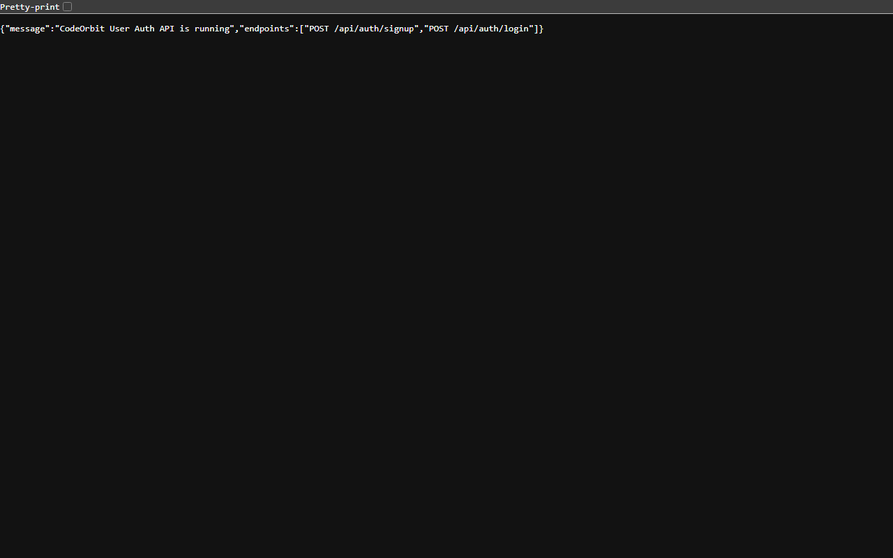
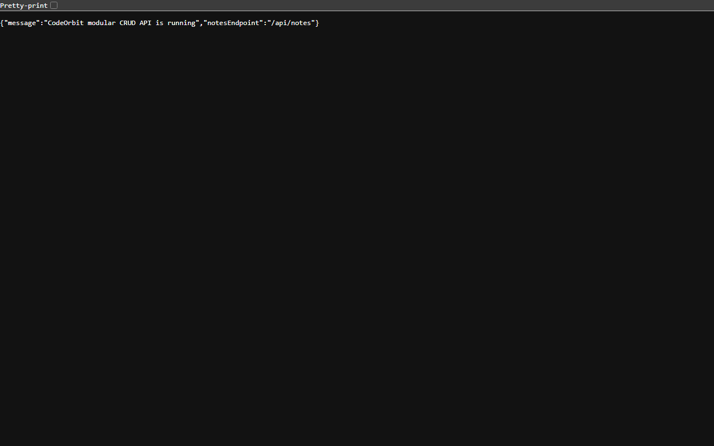

# CodeOrbit Backend Development Internship Projects

This repository contains three backend development projects created as part of the **CodeOrbit Tech Backend Development Internship Program**.

The projects demonstrate REST API development using Node.js and Express, user authentication, CRUD operations, input validation, and JSON-based data storage.

---

## Table of Contents
1. [Overview & Project Structure](#overview--project-structure)
2. [Project Ports](#project-ports)
3. [Prerequisites & Quick Start](#prerequisites--quick-start)
4. [API Testing Evidence (Postman)](#api-testing-evidence-postman)
   - [Localhost Verification](#localhost-verification)
   - [Task 1: Notes REST API](#task-1-notes-rest-api)
   - [Task 2: User Authentication API](#task-2-user-authentication-api)
   - [Task 3: Modular CRUD API](#task-3-modular-crud-api)
   - [Video Demonstration](#video-demonstration)
5. [Automated Test Suite & Postman Collections](#automated-test-suite--postman-collections)
6. [Learning Outcomes](#learning-outcomes)
7. [Internship Details](#internship-details)

---

## Overview & Project Structure

The repository is structured into three self-contained tasks:

### 1. Notes REST API (Task 1)
A REST API for managing notes.
* **Features:** Create notes, retrieve all notes, retrieve an individual note by ID, update existing notes, delete notes, validate input and handle errors.
* **Storage:** Persistent JSON storage in `data/notes.json`.
* **Technology:** Node.js, Express.js.
* **Default Port:** `3001`
* **Project Folder:** `CodeOrbit_Notes_REST_API`

### 2. User Authentication API (Task 2)
An API that supports secure user registration and login.
* **Features:** Register new users, validate user information, prevent duplicate registrations, verify login credentials, hash passwords before storing them (`bcryptjs`), and return safe public user responses without exposing password hashes.
* **Storage:** JSON storage in `data/users.json`.
* **Technology:** Node.js, Express.js, bcryptjs.
* **Default Port:** `3002`
* **Project Folder:** `CodeOrbit_User_Auth_API`

### 3. CRUD API (Task 3)
A full CRUD API demonstrating clean 3-tier architectural separation.
* **Features:** Create records, retrieve records, update records, delete records, validate input parameters and positive integer IDs.
* **Organization:** Routes (`routes/notesRoutes.js`), Controllers (`controllers/notesController.js`), and Data Layer (`data/notesData.js`).
* **Technology:** Node.js, Express.js.
* **Default Port:** `3003`
* **Project Folder:** `CodeOrbit_CRUD_API`

---

## Project Ports

- **Task 1 Notes REST API:** `http://localhost:3001`
- **Task 2 User Auth API:** `http://localhost:3002`
- **Task 3 Modular CRUD API:** `http://localhost:3003`

Each project runs on a distinct port, enabling all three servers to run concurrently on your local machine without port collisions.

---

## Prerequisites & Quick Start

### Prerequisites
* Node.js LTS (v18+)
* npm (v9+)
* Postman desktop app or any HTTP client

### Installation
Each project is independent and manages its own dependencies. To install:
```bash
# Task 1
cd CodeOrbit_Notes_REST_API
npm install

# Task 2
cd ../CodeOrbit_User_Auth_API
npm install

# Task 3
cd ../CodeOrbit_CRUD_API
npm install
```

### Running the Services
Start each service in a separate terminal:
```bash
# Terminal 1: Task 1 (Port 3001)
cd CodeOrbit_Notes_REST_API
npm start

# Terminal 2: Task 2 (Port 3002)
cd CodeOrbit_User_Auth_API
npm start

# Terminal 3: Task 3 (Port 3003)
cd CodeOrbit_CRUD_API
npm start
```

---

## API Testing Evidence (Postman)

### Localhost Verification

Below are genuine browser screenshots showing each application running on its designated localhost port and returning its active health-check JSON response:

#### Task 1: Notes REST API on Localhost:3001

- **URL:** `http://localhost:3001/`
- **Status:** `200 OK`
- **Payload:** `{"message":"CodeOrbit Notes REST API is running","endpoints":["GET /api/notes","POST /api/notes","GET /api/notes/:id","PUT /api/notes/:id","DELETE /api/notes/:id"]}`

#### Task 2: User Authentication API on Localhost:3002

- **URL:** `http://localhost:3002/`
- **Status:** `200 OK`
- **Payload:** `{"message":"CodeOrbit User Auth API is running","endpoints":["POST /api/auth/signup","POST /api/auth/login"]}`

#### Task 3: Modular CRUD API on Localhost:3003

- **URL:** `http://localhost:3003/`
- **Status:** `200 OK`
- **Payload:** `{"message":"CodeOrbit modular CRUD API is running","notesEndpoint":"/api/notes"}`

---

### Task 1: Notes REST API

**Base URL:** `http://localhost:3001`

#### 1. Root Health Check — GET `/`
- **Purpose:** Verify that the Notes REST API server is responsive and view available routes.
- **Endpoint:** `GET http://localhost:3001/`
- **Actual Result:** `HTTP 200 OK`. Returns welcoming confirmation and array of endpoints.

#### 2. Get All Notes — GET `/api/notes`
- **Purpose:** Retrieve all notes currently stored in `data/notes.json`.
- **Endpoint:** `GET http://localhost:3001/api/notes`
- **Actual Result:** `HTTP 200 OK`. Returns `{ "success": true, "data": [ ... ] }`.

#### 3. Create Note — POST `/api/notes`
- **Purpose:** Create a new note using the Notes REST API.
- **Endpoint:** `POST http://localhost:3001/api/notes`
- **Headers:** `Content-Type: application/json`
- **Request Body:**
  ```json
  {
    "title": "Task 1 Test Note",
    "content": "Building and testing beginner-friendly REST APIs with Node and Express"
  }
  ```
- **Actual Result:** `HTTP 201 Created`. Generated note record assigned unique ID with created timestamp.

#### 4. Get Note by ID — GET `/api/notes/:id`
- **Purpose:** Fetch a single note record by its unique ID.
- **Endpoint:** `GET http://localhost:3001/api/notes/2`
- **Actual Result:** `HTTP 200 OK`. Returned note record matching requested ID.

#### 5. Update Note — PUT `/api/notes/:id`
- **Purpose:** Modify the title and content of an existing note.
- **Endpoint:** `PUT http://localhost:3001/api/notes/2`
- **Headers:** `Content-Type: application/json`
- **Request Body:**
  ```json
  {
    "title": "Updated Task 1 Note",
    "content": "Updated note content verified successfully"
  }
  ```
- **Actual Result:** `HTTP 200 OK`. Returned updated note with fresh `updatedAt` ISO timestamp.

#### 6. Delete Note — DELETE `/api/notes/:id`
- **Purpose:** Remove an existing note by ID.
- **Endpoint:** `DELETE http://localhost:3001/api/notes/2`
- **Actual Result:** `HTTP 200 OK`. Returns `{ "success": true, "message": "Note deleted", "data": { ... } }`.

#### 7. Validation Test (Invalid Input) — POST `/api/notes`
- **Purpose:** Verify that blank or non-string inputs are properly rejected.
- **Endpoint:** `POST http://localhost:3001/api/notes`
- **Headers:** `Content-Type: application/json`
- **Request Body:**
  ```json
  {
    "title": "",
    "content": "Invalid note test"
  }
  ```
- **Actual Result:** `HTTP 400 Bad Request`. Returns `{ "success": false, "message": "title must be a non-empty string and content must be a string" }`.

---

### Task 2: User Authentication API

**Base URL:** `http://localhost:3002`

#### 1. Signup with Valid Test Details — POST `/api/auth/signup`
- **Purpose:** Register a new user with secure password hashing (`bcryptjs`).
- **Endpoint:** `POST http://localhost:3002/api/auth/signup`
- **Headers:** `Content-Type: application/json`
- **Request Body:**
  ```json
  {
    "name": "QA Test Engineer",
    "email": "intern.qa.test@codeorbit.test",
    "password": "Password#2026"
  }
  ```
- **Actual Result:** `HTTP 201 Created`. User created successfully; returns public user object (`id`, `name`, `email`, `createdAt`) without leaking password hash.

#### 2. Login with Correct Credentials — POST `/api/auth/login`
- **Purpose:** Authenticate an existing user with valid email and password.
- **Endpoint:** `POST http://localhost:3002/api/auth/login`
- **Headers:** `Content-Type: application/json`
- **Request Body:**
  ```json
  {
    "email": "intern.qa.test@codeorbit.test",
    "password": "Password#2026"
  }
  ```
- **Actual Result:** `HTTP 200 OK`. Returns `{ "success": true, "message": "Login successful", "user": { ... } }`.

#### 3. Login with Incorrect Password — POST `/api/auth/login`
- **Purpose:** Verify authentication rejection upon supplying wrong password.
- **Endpoint:** `POST http://localhost:3002/api/auth/login`
- **Headers:** `Content-Type: application/json`
- **Request Body:**
  ```json
  {
    "email": "intern.qa.test@codeorbit.test",
    "password": "WrongPassword999"
  }
  ```
- **Actual Result:** `HTTP 401 Unauthorized`. Returns `{ "success": false, "message": "Invalid email or password" }`.

#### 4. Duplicate Signup — POST `/api/auth/signup`
- **Purpose:** Ensure duplicate registrations with existing emails are rejected.
- **Endpoint:** `POST http://localhost:3002/api/auth/signup`
- **Headers:** `Content-Type: application/json`
- **Request Body:**
  ```json
  {
    "name": "Duplicate User",
    "email": "intern.qa.test@codeorbit.test",
    "password": "AnotherPassword123"
  }
  ```
- **Actual Result:** `HTTP 409 Conflict`. Returns `{ "success": false, "message": "An account with this email already exists" }`.

#### 5. Validation Test (Missing/Short Fields) — POST `/api/auth/signup`
- **Purpose:** Ensure minimum string length constraints and email formats are enforced.
- **Endpoint:** `POST http://localhost:3002/api/auth/signup`
- **Headers:** `Content-Type: application/json`
- **Request Body:**
  ```json
  {
    "name": "A",
    "email": "not-an-email",
    "password": "short"
  }
  ```
- **Actual Result:** `HTTP 400 Bad Request`. Returns `{ "success": false, "message": "Name must contain at least 2 characters" }`.

---

### Task 3: Modular CRUD API

**Base URL:** `http://localhost:3003`

#### 1. Root Health Check — GET `/`
- **Purpose:** Verify modular service is running and exposes `/api/notes`.
- **Endpoint:** `GET http://localhost:3003/`
- **Actual Result:** `HTTP 200 OK`. Returns `{ "message": "CodeOrbit modular CRUD API is running", "notesEndpoint": "/api/notes" }`.

#### 2. Get All Records — GET `/api/notes`
- **Purpose:** Retrieve all records via `notesController.listNotes` and `notesData.getAll`.
- **Endpoint:** `GET http://localhost:3003/api/notes`
- **Actual Result:** `HTTP 200 OK`. Returns array of note records.

#### 3. Create Record — POST `/api/notes`
- **Purpose:** Validate and save a new note record through controller and data layers.
- **Endpoint:** `POST http://localhost:3003/api/notes`
- **Headers:** `Content-Type: application/json`
- **Request Body:**
  ```json
  {
    "title": "Modular Architecture Note",
    "content": "Separating concerns across routes, controllers, and data storage layers"
  }
  ```
- **Actual Result:** `HTTP 201 Created`. Created record with ID `2`.

#### 4. Get Record by ID — GET `/api/notes/:id`
- **Purpose:** Validate positive integer ID and fetch single record.
- **Endpoint:** `GET http://localhost:3003/api/notes/2`
- **Actual Result:** `HTTP 200 OK`. Returned specific note matching requested ID.

#### 5. Update Record — PUT `/api/notes/:id`
- **Purpose:** Update record fields via controller logic.
- **Endpoint:** `PUT http://localhost:3003/api/notes/2`
- **Headers:** `Content-Type: application/json`
- **Request Body:**
  ```json
  {
    "title": "Updated Modular Architecture Note",
    "content": "Updated content verified through controller logic"
  }
  ```
- **Actual Result:** `HTTP 200 OK`. Record updated and returned with `updatedAt`.

#### 6. Delete Record — DELETE `/api/notes/:id`
- **Purpose:** Remove record by ID through data access layer.
- **Endpoint:** `DELETE http://localhost:3003/api/notes/2`
- **Actual Result:** `HTTP 200 OK`. Returns `{ "success": true, "message": "Note deleted", "data": { ... } }`.

#### 7. Validation Test (Missing Title) — POST `/api/notes`
- **Purpose:** Verify required property validation in controller.
- **Endpoint:** `POST http://localhost:3003/api/notes`
- **Headers:** `Content-Type: application/json`
- **Request Body:**
  ```json
  {
    "content": "Missing title property"
  }
  ```
- **Actual Result:** `HTTP 400 Bad Request`. Returns `{ "success": false, "message": "title is required and content must be a string" }`.

#### 8. Validation Test (Invalid ID Format) — GET `/api/notes/:id`
- **Purpose:** Verify non-numeric or non-integer ID validation.
- **Endpoint:** `GET http://localhost:3003/api/notes/invalid_id`
- **Actual Result:** `HTTP 400 Bad Request`. Returns `{ "success": false, "message": "Note ID must be a positive integer" }`.

---

### Video Demonstration

- **Demonstration Guide & Script:** Available in [`VIDEO_SCRIPT.md`](VIDEO_SCRIPT.md).
- **Postman Collection for Demo:** Pre-configured collection files ready for one-click import into Postman Desktop:  
  - Unified: [`SUBMISSION_EVIDENCE/postman/CodeOrbit_All_Projects.postman_collection.json`](SUBMISSION_EVIDENCE/postman/CodeOrbit_All_Projects.postman_collection.json)
  - Task 1: [`SUBMISSION_EVIDENCE/postman/CodeOrbit_Notes_REST_API.postman_collection.json`](SUBMISSION_EVIDENCE/postman/CodeOrbit_Notes_REST_API.postman_collection.json)
  - Task 2: [`SUBMISSION_EVIDENCE/postman/CodeOrbit_User_Auth_API.postman_collection.json`](SUBMISSION_EVIDENCE/postman/CodeOrbit_User_Auth_API.postman_collection.json)
  - Task 3: [`SUBMISSION_EVIDENCE/postman/CodeOrbit_CRUD_API.postman_collection.json`](SUBMISSION_EVIDENCE/postman/CodeOrbit_CRUD_API.postman_collection.json)
- **Video Submission Location:** When recorded following `VIDEO_SCRIPT.md`, save the 2–5 minute presentation video at:
  ```
  SUBMISSION_EVIDENCE/CodeOrbit_API_Testing_Demo.mp4
  ```

---

## Automated Test Suite & Postman Collections

- **Postman Collections:** Available under [`SUBMISSION_EVIDENCE/postman/`](SUBMISSION_EVIDENCE/postman/)
- **Test Execution Results (JSON):** [`SUBMISSION_EVIDENCE/test_execution_results.json`](SUBMISSION_EVIDENCE/test_execution_results.json)
- **Comprehensive QA Test Report:** [`SUBMISSION_EVIDENCE/TEST_REPORT.md`](SUBMISSION_EVIDENCE/TEST_REPORT.md)

---

## Learning Outcomes

* Understanding REST API principles and HTTP status codes (`200`, `201`, `400`, `401`, `404`, `409`).
* Building backend services using Node.js and Express.
* Password hashing with `bcryptjs` and secure response sanitization.
* Modular 3-tier software architecture (Routes, Controllers, Data layer).
* Validating incoming requests and handling edge cases gracefully.
* API testing, documentation, and quality assurance evidence generation.

---

## Internship Details

* **Program:** CodeOrbit Tech — Backend Development Internship
* **Track:** 1 Month Internship (3 Tasks)
* **Author / Intern:** Manish
* **Repository:** [CodeOrbit-Backend-Internship](https://github.com/ManishX-ui/CodeOrbit-Backend-Internship.git)

---

*Developed and tested for the CodeOrbit Tech Backend Development Internship.*
